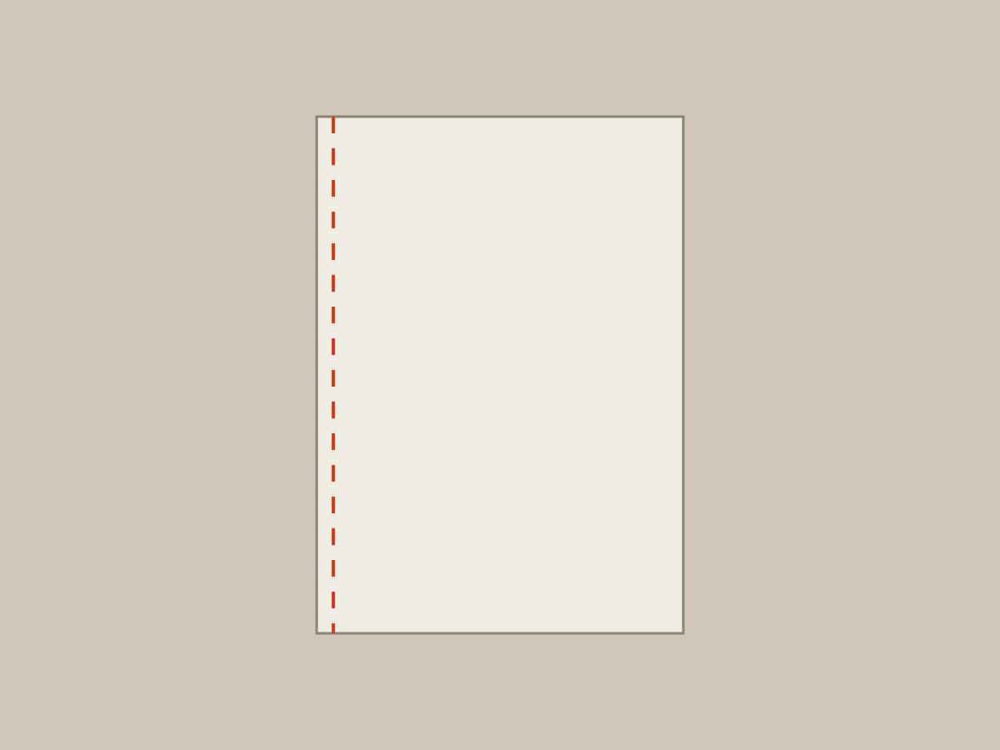

# Cuaderno cosido

## Qué es

Un cuaderno hecho con las hojas que sobraron del *Mapa de ausencias*. Es una ficha de artefacto de ejemplo: lo que existe como cosa, con técnica, medidas y dónde está.
